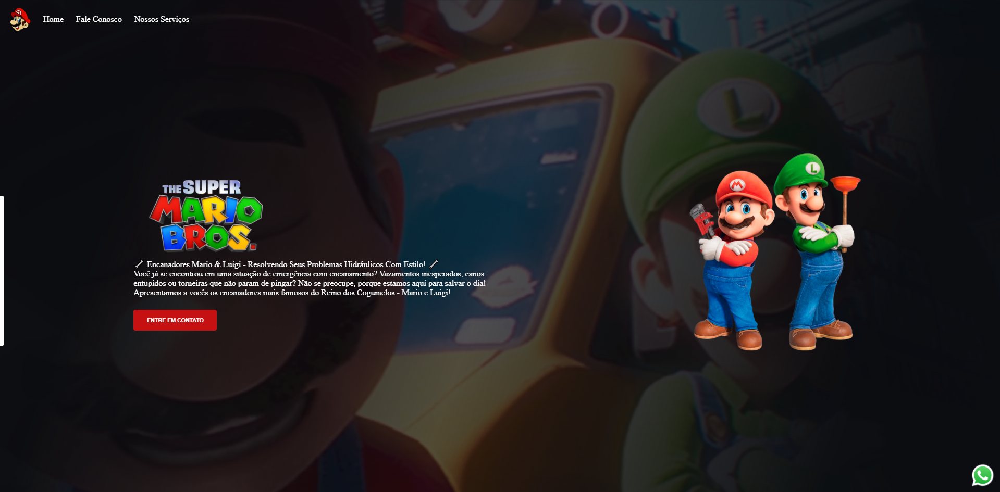
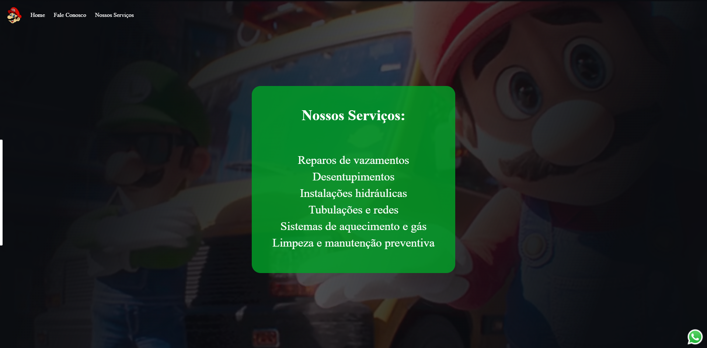

# 🔧 Encanadores Mario & Luigi

Site de uma empresa fictícia de serviços hidráulicos, inspirado no universo de **Super Mario Bros.** Feito para praticar HTML, CSS e JavaScript, com foco em layout e design.

## 📸 Preview




## 🔗 Acesse o site

[Clique aqui para ver o projeto online](https://pedro021-lab.github.io/Site_Mario_bros/)

## ✨ Funcionalidades

- Menu de navegação com acesso às seções **Home**, **Fale Conosco** e **Nossos Serviços**
- Página inicial com apresentação da empresa e botão **Entre em contato**
- Seção de serviços em um cartão verde com fundo semitransparente
- Botão flutuante do WhatsApp, sempre visível no canto da tela
- Fundo temático com imagens do Mario e do Luigi

## 🛠️ Serviços apresentados no site

- Reparos de vazamentos
- Desentupimentos
- Instalações hidráulicas
- Tubulações e redes
- Sistemas de aquecimento e gás
- Limpeza e manutenção preventiva

## 💻 Tecnologias utilizadas

- **HTML5**: estrutura das páginas
- **CSS3**: estilização e layout (Flexbox, sistema do CSS para alinhar elementos)
- **JavaScript**: interações do site

## 🚀 Como rodar o projeto

1. Clone (baixe uma cópia do) o repositório:
   ```bash
   git clone https://github.com/Pedro021-lab/Site_Mario_bros.git
   ```
2. Entre na pasta do projeto:
   ```bash
   cd Site_Mario_bros
   ```
3. Abra o arquivo `index.html` no navegador.

## 📁 Estrutura do projeto

```
Site_mario_bros/
├── index.html
├── nossosServicos.html
├── style.css
├── nossosServicos.css
├── script.js
└── imagens/
```

## 👤 Autor

Feito por **Pedro Moraes**.

- GitHub: [@Pedro021-lab](https://github.com/Pedro021-lab)

---

⚠️ Projeto criado apenas para fins de estudo. Mario, Luigi e Super Mario Bros. pertencem à Nintendo.
